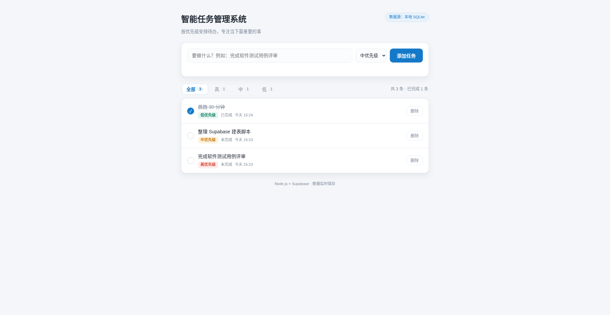

# 智能任务管理系统

Node.js + Supabase 实现的任务管理应用：输入框 + 优先级下拉添加任务，列表按创建时间倒序展示，支持完成/未完成切换、删除与优先级筛选。



## 功能

- 添加任务：`输入框` + `优先级下拉（高 / 中 / 低）`
- 任务列表：显示标题、优先级标签、完成状态、创建时间
- 每条任务自带「切换完成状态」圆钮与「删除」按钮
- 优先级筛选：全部 / 高 / 中 / 低（带实时数量角标）
- 已完成任务标题加删除线并置灰
- 全部中文界面，适配移动端

## 在线演示

- GitHub Pages（国内网络可用，浏览器直连 Supabase）：<https://meijiaheng.github.io/system/>
- 该地址发布的是 `docs/index.html`，与 `standalone/index.html` 内容一致，改动时两份一起更新。

## 部署到 Vercel

仓库已带 `vercel.json`，把 Express 应用注册为 Node 函数、`public/` 作为静态资源，导入仓库后可直接部署。

**必须配置环境变量**（Vercel → Project → Settings → Environment Variables，Production 环境）：

| Name | Value |
| --- | --- |
| `SUPABASE_URL` | `https://xxxx.supabase.co` |
| `SUPABASE_ANON_KEY` | 你的 anon key |

不加这两项，线上会退到本地 SQLite，而 Vercel 的文件系统是临时的，数据存不住。

```bash
npm i -g vercel
vercel --prod      # 或在 Vercel 面板导入 GitHub 仓库，推送 main 自动部署
```

> 如果 `*.vercel.app` 在你所在网络打不开（连接超时），说明是域名不可达而非部署失败。绑定自定义域名，或直接用下面的单文件版。

## 单文件版（无需后端 / 无需 Node）

`standalone/index.html` 是一个自包含页面：浏览器直接调用 Supabase REST API，没有后端，双击即可运行，也可以丢到任意静态托管。

- 打开前把文件顶部 `SUPABASE_URL`、`SUPABASE_KEY` 换成自己的项目；
- 依赖 Supabase 侧允许匿名读写的 RLS 策略（见 `supabase/schema.sql`）；
- 适合做演示、临时使用，或后端跑不起来时兜底。

## 快速开始

```bash
npm install
cp .env.example .env   # 填入自己的 Supabase URL 与 anon key
npm start              # 打开 http://localhost:3000
```

未配置 Supabase 凭据时，程序自动使用本地 SQLite（`data/tasks.db`）兜底，重启后数据仍在。

## Supabase 配置

1. 在 [Supabase](https://supabase.com) 新建项目，进入 **SQL Editor**，粘贴执行 `supabase/schema.sql`（建表 + 索引 + RLS 策略）。
2. 进入 **Project Settings → API**，复制 `Project URL` 与 `anon public key`。
3. 复制 `.env.example` 为 `.env` 并填入：

```env
SUPABASE_URL=https://xxxx.supabase.co
SUPABASE_ANON_KEY=你的 anon key
```

4. 重启服务。启动日志出现 `[db] 已连接 Supabase`，页面右上角角标变为「数据源：Supabase」，数据即写入云端。

> 说明：若 Supabase 域名不可达或凭据填错，程序会在启动时自动降级回本地 SQLite，不会出现"页面能点但数据写不进去"的假象。角标始终告诉你数据真实存放位置。

## 数据表结构

`tasks`（Supabase 与本地 SQLite 两侧一致，仅类型适配）：

| 字段 | 类型 | 说明 |
| --- | --- | --- |
| `id` | bigint 自增主键 | 本地为 `integer primary key autoincrement` |
| `title` | text | 任务标题，最长 120 字符 |
| `priority` | text | `'高'` / `'中'` / `'低'`（中文入库） |
| `completed` | boolean，默认 false | 本地存 0/1 |
| `created_at` | timestamptz，默认当前时间 | 本地存 ISO 字符串 |

## 目录结构

```
.
├── server.js              # Express 入口：静态资源 + /api 路由 + 错误处理
├── src/
│   ├── db/
│   │   ├── index.js       # 数据层工厂：Supabase 优先，不可用则 SQLite
│   │   ├── supabaseRepo.js# @supabase/supabase-js 走 REST API
│   │   └── sqliteRepo.js  # Node 22 内置 node:sqlite，零额外依赖
│   ├── routes/tasks.js    # 任务接口
│   └── utils/validate.js  # 标题 / 优先级 / 筛选参数校验
├── public/
│   ├── index.html
│   ├── style.css
│   └── app.js             # 原生 fetch 渲染，无前端框架
├── supabase/schema.sql    # 建表脚本
├── data/tasks.db          # 本地兜底数据库（git 忽略）
└── docs/preview.png
```

## 接口

| 方法   | 路径                          | 说明                                       |
| ------ | ----------------------------- | ------------------------------------------ |
| GET    | `/api/tasks?priority=all`     | 列表，按创建时间倒序；`priority` 可选 `高/中/低` |
| POST   | `/api/tasks`                  | 新增，body：`{ "title": "...", "priority": "高" }` |
| PATCH  | `/api/tasks/:id`              | 切换完成状态，body 可选 `{ "completed": true }`；不传则取反 |
| DELETE | `/api/tasks/:id`              | 删除                                       |
| GET    | `/api/meta`                   | 当前数据源：`{"driver":"supabase"｜"sqlite"}` |

响应统一为 `{ "data": ... }`；出错为 `{ "error": "中文提示" }`，状态码 400 / 404 / 500。

## 双数据层设计（学习要点）

两个 Repo 保持同一套方法签名与同一份字段契约：

```js
list(priority) / get(id) / create({title, priority}) / toggle(id, completed) / remove(id)
```

只做类型适配：Supabase 用 `bigint + boolean + timestamptz`，SQLite 用 `integer 自增 + 0/1 + ISO 字符串`；优先级在两侧都存中文，业务层与路由层完全不感知底层差异，换库不需要改一行业务代码。

`src/db/index.js` 的选层逻辑：

```js
有 SUPABASE_URL 与 SUPABASE_ANON_KEY → createSupabaseRepo（先试查一次，失败自动降级）
否则                                → createSqliteRepo
```

## 安全提示

- `.env` 已加入 `.gitignore`，anon key 不会进仓库；仓库里只有 `.env.example` 占位模板。
- 演示用的 RLS 策略允许匿名读写，方便直接跑通。正式环境建议接 Supabase Auth，改为按 `auth.uid()` 隔离：`using (user_id = auth.uid())`，表增加 `user_id uuid` 字段。
- 若使用 `service_role` key，只放在服务端，绝不暴露给浏览器。
